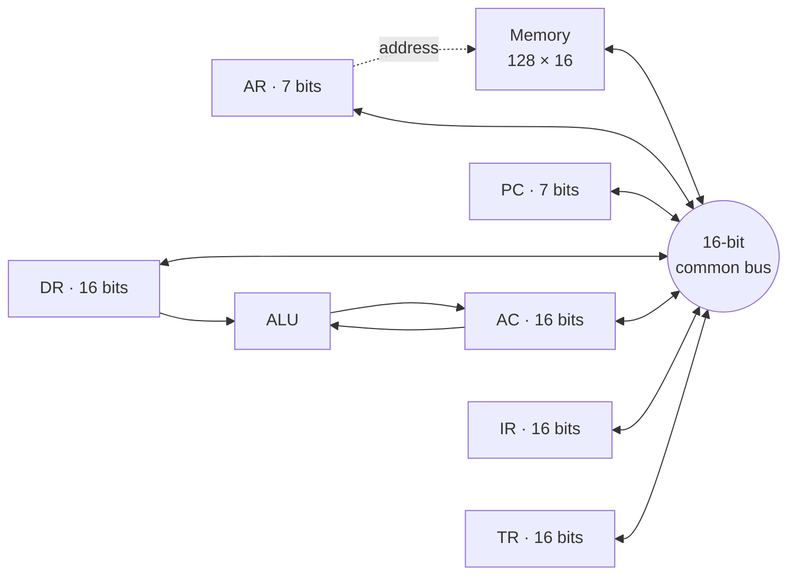
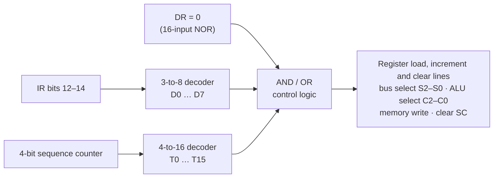

<div align="center">

# 🖥️ 16-Bit Basic Computer in Logisim

**A small stored-program computer built gate by gate in Logisim: a common-bus datapath with six registers and 128 words of memory, a seven-operation ALU, and a hardwired control unit that fetches, decodes and executes seven instructions.**


</div>

---

## Overview

The computer was built in two milestones:

| Milestone | What was built |
|---|---|
| **1. Datapath** | Memory, registers and ALU connected through a 16-bit common bus, with every load, increment and select line driven by hand |
| **2. Control unit** | A hardwired control unit that generates all of those signals from the instruction and the current timing step, so the computer runs programs on its own |

| | |
|---|---|
| Word size | 16 bits |
| Memory | 128 × 16-bit RAM (7-bit addresses) |
| Registers | AR (7), PC (7), DR (16), AC (16), IR (16), TR (16), plus a 4-bit sequence counter |
| ALU operations | 7 |
| Instructions | 7: `LDA`, `STA`, `ADD`, `MUL`, `DIV`, `ISZ`, `BUN` |
| Control | Hardwired: two decoders plus AND/OR logic, no microcode |

---

## Datapath

Every register and the memory place their value on a shared 16-bit bus through an 8-to-1 multiplexer. The control unit picks the source with the select lines **S2 S1 S0** and loads it into any register that has its load line set.



| S2 S1 S0 | Source on the bus |
|:---:|---|
| `000` | Memory word `M[AR]` |
| `001` | AR |
| `010` | PC |
| `011` | AC |
| `100` | DR |
| `101` | TR |
| `110` | External input pin (used for testing) |
| `111` | IR |

### ALU

The ALU takes **DR** and **AC** as inputs and writes its result into **AC**. An 8-to-1 multiplexer chooses the operation with **C2 C1 C0**.

| C2 C1 C0 | Operation |
|:---:|---|
| `000` | DR (transfer) |
| `001` | DR + 1 |
| `010` | DR × AC |
| `011` | DR − AC |
| `100` | DR ÷ AC |
| `101` | DR + AC |
| `110` | DR ⊕ AC |

---

## Control unit



The opcode decoder says **which** instruction is running and the timing decoder says **which step** it is on. Each control signal is an OR of the (instruction, step) pairs that need it. For example, `LD-AC` is active on D2·T5 (`LDA`), D1·T5 (`ADD`) and so on. A D flip-flop synchronises clearing the sequence counter with the clock, so the next instruction starts cleanly at T0.

### Fetch and decode (every instruction)

| Step | Micro-operations |
|:---:|---|
| T0 | `AR ← PC` |
| T1 | `IR ← M[AR]`, `PC ← PC + 1` |
| T2 | Decode opcode into D0–D7, `AR ← IR(0–11)`, `I ← IR(15)` |

### Execute

| Instruction | Line | Meaning | Micro-operations |
|---|:---:|---|---|
| `DIV` | D0 | `AC ← AC ÷ M[X]` | T4: `DR ← M[AR]` · T5: `TR ← AC`, `AC ← DR` · T6: `DR ← TR` · T7: `AC ← DR ÷ AC`, `SC ← 0` |
| `ADD` | D1 | `AC ← AC + M[X]` | T4: `DR ← M[AR]` · T5: `AC ← AC + DR`, `SC ← 0` |
| `LDA` | D2 | `AC ← M[X]` | T4: `DR ← M[AR]` · T5: `AC ← DR`, `SC ← 0` |
| `STA` | D3 | `M[X] ← AC` | T4: `M[AR] ← AC`, `SC ← 0` |
| `BUN` | D4 | Jump to X | T4: `PC ← AR`, `SC ← 0` |
| `MUL` | D5 | `AC ← AC × M[X]` | T4: `DR ← M[AR]` · T5: `AC ← AC × DR`, `SC ← 0` |
| `ISZ` | D6 | Increment `M[X]`, skip the next instruction if it becomes 0 | T4: `DR ← M[AR]` · T5: `AC ← DR + 1` · T6: `DR ← AC` · T7: `M[AR] ← DR`, if `DR = 0` then `PC ← PC + 1`, `SC ← 0` |

### Test program

The milestone was tested with a loop that uses every instruction:

```
loop:  LDA A
       DIV B
       ADD C
       STA C        ; C ← A ÷ B + C
       LDA A
       MUL B
       ADD A
       STA A        ; A ← A × B + A
       ISZ counter  ; when the counter reaches 0, skip the jump and stop looping
       BUN loop
```

---

## Run it

1. Install [Logisim](http://www.cburch.com/logisim/) 2.7.1 (or [Logisim Evolution](https://github.com/logisim-evolution/logisim-evolution), which also opens these files).
2. Open [`circuits/basic-computer.circ`](circuits/basic-computer.circ). The `main` circuit is the computer, and `ALU` and `CU` are its sub-circuits.
3. Right-click the RAM and choose **Edit Contents** to load a program and its data.
4. Tick the clock (<kbd>Ctrl</kbd>+<kbd>T</kbd>) or enable automatic ticking, and watch the registers change step by step.

[`circuits/milestone1-datapath.circ`](circuits/milestone1-datapath.circ) contains the Milestone 1 datapath, where you drive the bus and load lines yourself.

---

## Looking back

- **Division takes four steps because the ALU only computes `DR ÷ AC`.** `DIV` has to swap the operands through TR first. An ALU option for `AC ÷ DR` would let it finish in two steps, like `ADD` and `MUL`.
- **`ISZ` overwrites AC.** The increment happens in the ALU, whose output can only go to AC. Giving DR its own increment line (as in Mano's basic computer) would make `ISZ` leave AC unchanged and save a step.
- **Most of the wiring uses tunnels.** Tunnels keep the CU readable, but with about 200 of them, tracing a single signal is slow. Grouping related signals into buses would make the circuit easier to follow.

---

## Team & course

Built for **Computer Organization & System Programming**, German University in Cairo, Spring 2024.

**Team 34:** Daniel Ehab · Ahmed Hossam Badran · Abdelrahman Mahmoud · Alqassem Shereif Maged · Zyad Mohamed Naguib
